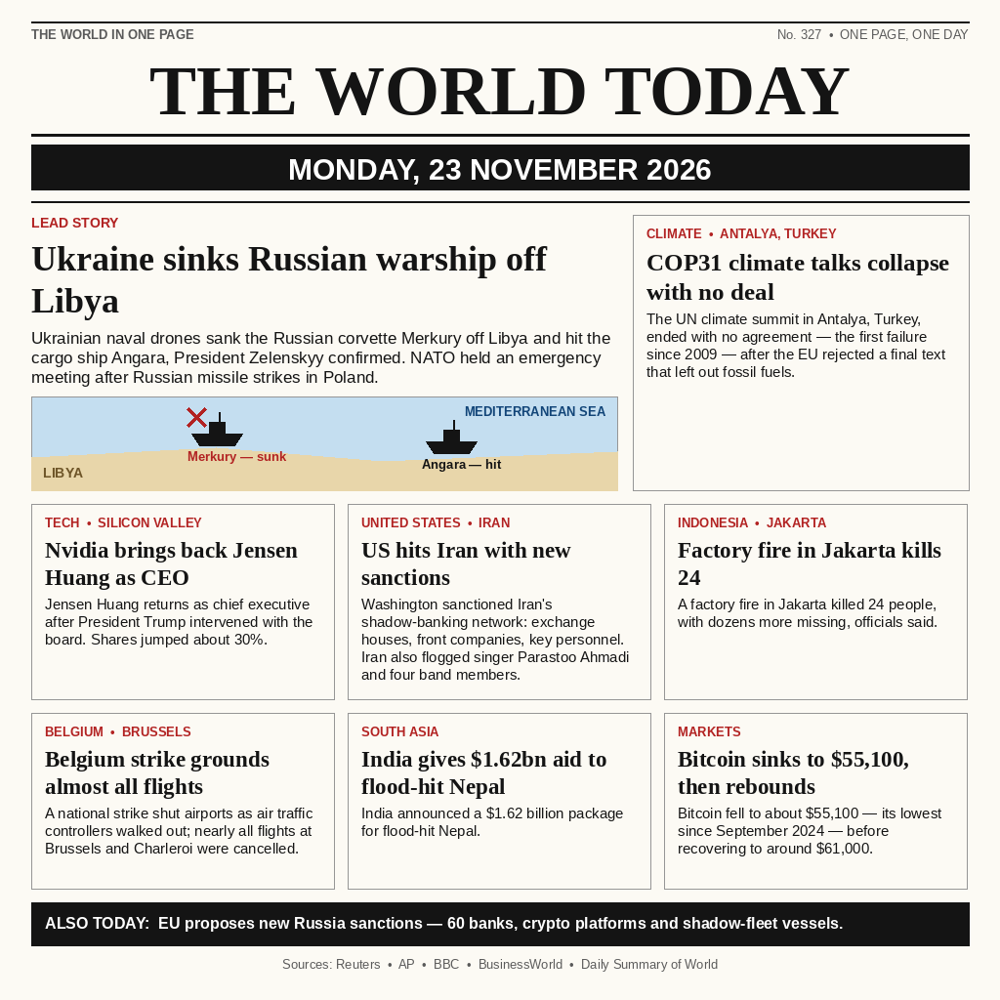

[](https://make.fun/bounty/news-image-20261123?utm_source=github&utm_medium=readme&utm_campaign=news-image-20261123)
[](https://make.fun/bounty/news-image-20261123/leaderboard?utm_source=github&utm_medium=readme&utm_campaign=news-image-20261123)
[](https://make.fun/bounty/news-image-20261123?utm_source=github&utm_medium=readme&utm_campaign=news-image-20261123)

# The World in One Page — Monday, 23 November 2026

A single newspaper front page that sums up the world's news of **Monday, 23 November 2026**. Every story on the page happened on that day; nothing from any other day is included.



## How it is built

The image is drawn from scratch by `tools/generate_image.py` (Python + Pillow, using the system Liberation fonts). It is a 1024 × 1024 PNG: a masthead carrying the date, a lead story with a small schematic map of the Mediterranean, six further story panels, an "also today" strip, and a sources footer. `main.ts` (Node 22, standard library only) simply copies `entry.png` into the output directory given by `MAKEFUN_OUTPUT_DIR` (default `/output`).

To rebuild the image:

```sh
python3 tools/generate_image.py
```

## Stories on the page

| # | Story | What the page says |
|---|-------|--------------------|
| 1 | **Lead — Ukraine sinks Russian warship off Libya** | Ukrainian naval drones sank the Russian corvette Merkury off Libya and hit the cargo ship Angara; President Zelenskyy confirmed it. NATO held an emergency meeting after Russian missile strikes in Poland. |
| 2 | **COP31 climate talks collapse** | The UN climate summit in Antalya, Turkey, ended with no deal — the first failure since 2009 — after the EU rejected a final text that left out fossil fuels. |
| 3 | **Nvidia brings back Jensen Huang as CEO** | Jensen Huang returned as chief executive after President Trump intervened with the board; shares jumped about 30%. |
| 4 | **US imposes new Iran sanctions** | Washington sanctioned Iran's shadow-banking network — more than two dozen exchange houses, front companies and key personnel, according to the Treasury. Iran also flogged singer Parastoo Ahmadi and four band members. |
| 5 | **Indonesia factory fire kills 24** | A factory fire in Jakarta killed 24 people, with dozens more missing. |
| 6 | **Belgium national strike shuts airports** | Nearly all flights at Brussels and Charleroi were cancelled as air traffic controllers walked out. |
| 7 | **India gives $1.62 billion to flood-hit Nepal** | India announced a $1.62 billion package for flood-hit Nepal. |
| 8 | **Markets — Bitcoin falls, then rebounds** | Bitcoin fell to about $55,100, its lowest since September 2024, then recovered to around $61,000. |
| — | **Also today** | The EU proposed new Russia sanctions covering 60 banks, crypto platforms and shadow-fleet vessels. |

## Sources

Reuters, AP, BBC, BusinessWorld, Daily Summary of World.

## Notes on accuracy

- Wording sticks to what was reported on the day: no hype, no speculation presented as fact, and no stories borrowed from 22 or 24 November.
- The map beside the lead story is a schematic diagram of the Mediterranean and the Libyan coast, not a geographic survey — it only shows where the two ships were reported.

---

Built for the [make.fun](https://make.fun) bounty "Sum up 23 November's world news in one image" (news-image-20261123).
